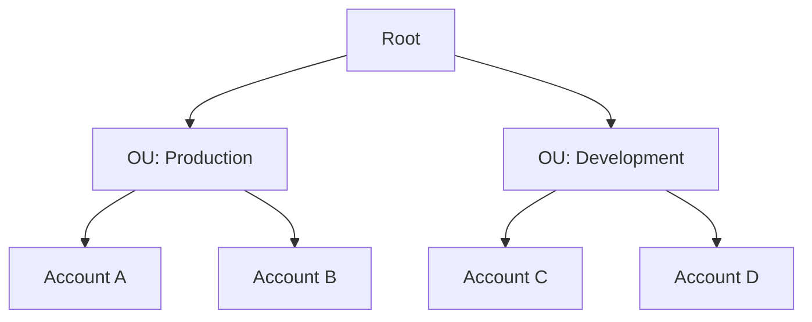

# Runbook: Service Control Policy (SCP) Deleted

**Severity:** Varies. Higher if the SCP was attached or recently detached

**Data source:** AWS CloudTrail (AWS Organizations events)

## Description

Someone deleted a Service Control Policy (SCP) in AWS Organizations. Often this is routine cleanup, but SCPs are security boundaries, so removing one can weaken controls across many accounts.

## Background

> **What is an SCP?** A policy that sets the **maximum** permissions for accounts in an AWS organization. It never grants permissions. It only limits what users and roles can do, even if their own permissions allow more.

> **What is AWS Control Tower?** A service that sets up and governs multi account AWS environments. It applies security rules called **controls** (previously called guardrails). Many are SCPs named with the prefix `aws-guardrails-`.

An SCP only has an effect when it's **attached** to something:

- Attached to the **root**: affects every member account
- Attached to an **OU** (organizational unit): affects the accounts in that OU
- Attached to an **account**: affects that account only
- Attached to **nothing**: affects nobody

**Good to know:** SCPs don't affect the management account, only member accounts.

## Example (fictional)

A change note says:

> "Removed Control Tower guardrail SCP `aws-guardrails-EXAMPLE`. It was attached to no account or OU, so removing it changed no account's permissions. I saved its contents first."

**What this claims:**

| Claim | What it means |
|---|---|
| Attached to no account or OU | The SCP wasn't restricting anyone |
| Changed no account's permissions | No restrictions were lifted, so no account gained access |
| Saved its contents first | The policy document (JSON) was copied, so it can be reviewed or restored |

**What it doesn't tell you:** whether the deletion was **approved**, and whether the SCP was **meant** to be attached somewhere. Your job is to verify the claims, not accept them.

## Triage and Response

1. **Find the deletion event.** In CloudTrail, look for `DeletePolicy` from `organizations.amazonaws.com`. Note who did it, when, and from which IP.
2. **Check for a recent detach.** Search for `DetachPolicy` on the same policy ID in the days before. If it was detached just before deletion, the permission change happened at the detach, and those accounts lost a restriction.
3. **Check the change log.** Is there an approved change record for this?
4. **Confirm the saved copy exists.** Ask for it, and check where it's stored.
5. **Check for Control Tower drift.** Control Tower managed SCPs are meant to be changed through Control Tower. Changes made elsewhere can cause drift, so check with the cloud team whether Control Tower reports any.
6. **Check what the policy restricted.** If it blocked something sensitive, like disabling logging or leaving the organization, its removal deserves a closer look even if it was unattached.

### No CloudTrail access?

Many Tier 1 analysts can't open the AWS console. You can still cover most of the steps above.

**1. Search your SIEM.** If your company forwards CloudTrail to its SIEM, the same events should be there. Look for:

| Field | What to look for |
|---|---|
| `eventSource` | `organizations.amazonaws.com` |
| `eventName` | `DeletePolicy`, and `DetachPolicy` in the days before |
| `requestParameters.policyId` | The same policy ID in both events |
| `userIdentity` | Who made the change |
| `sourceIPAddress` | Where the change came from |
| `eventTime` | When. Compare the detach and delete times |

Field names may differ depending on how your SIEM ingests CloudTrail. Start from one known CloudTrail event to see how your environment labels them.

**2. Check the change log.** You don't need AWS access to see if a change was approved.

**3. Ask the cloud team to confirm:**
- Was the SCP attached to anything when it was deleted?
- Was it detached recently, and when?
- Where is the saved copy?
- Does Control Tower report any drift?

**4. Write down what you couldn't verify.** In your notes and escalation, say clearly which checks were done by you and which were confirmed by someone else. For example: "Cloud team confirmed the SCP was unattached. I could not verify this directly."

> If CloudTrail isn't in your SIEM and nobody can confirm the details, escalate. An unverified security control change shouldn't be closed on someone's word alone.

## Decision Logic

| What you found | Action |
|---|---|
| Unattached, no recent detach, approved change, copy saved | Close as true positive: benign. Document the change ID |
| Unattached, but no change record | Contact the person who made the change, then escalate if unexplained |
| Detached shortly before deletion | Escalate to Tier 2. Permissions **did** change, at the detach |
| Person who made the change can't be identified, or denies it | **Escalate immediately as a potential incident** |
| Other security controls removed or changed around the same time | **Escalate immediately.** Possible defense evasion |

## Escalation

Include:

- Policy name and ID, who deleted it, when, and the source IP
- Whether it was attached at deletion, and any recent `DetachPolicy` events
- Change record, or lack of one
- Whether a copy of the policy was saved
- Your recommendation (for example: restore the policy, review other recent Organizations changes)

Use the [Escalation Message Template](../00-start-here/escalation-message-template.md).

## References

- [AWS Organizations: Service control policies](https://docs.aws.amazon.com/organizations/latest/userguide/orgs_manage_policies_scps.html)
- [AWS Control Tower: Delete SCPs](https://docs.aws.amazon.com/controltower/latest/userguide/controltower-walkthrough-delete-scps.html)
- [AWS Control Tower: Detect and resolve drift](https://docs.aws.amazon.com/controltower/latest/userguide/drift.html)
